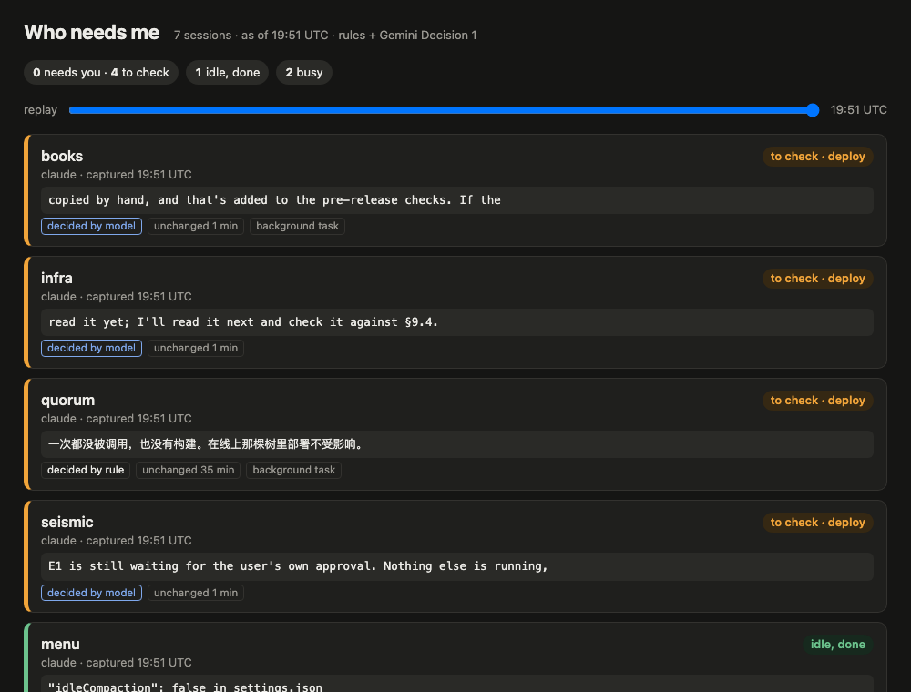
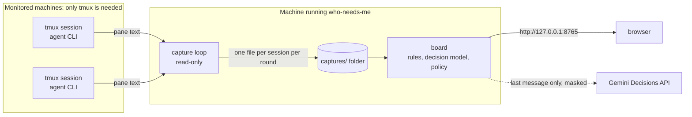
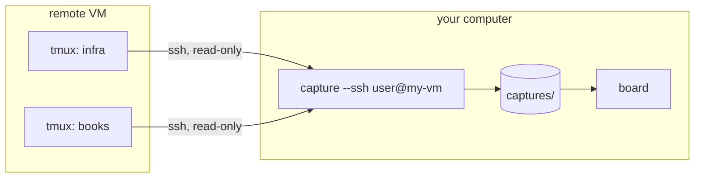
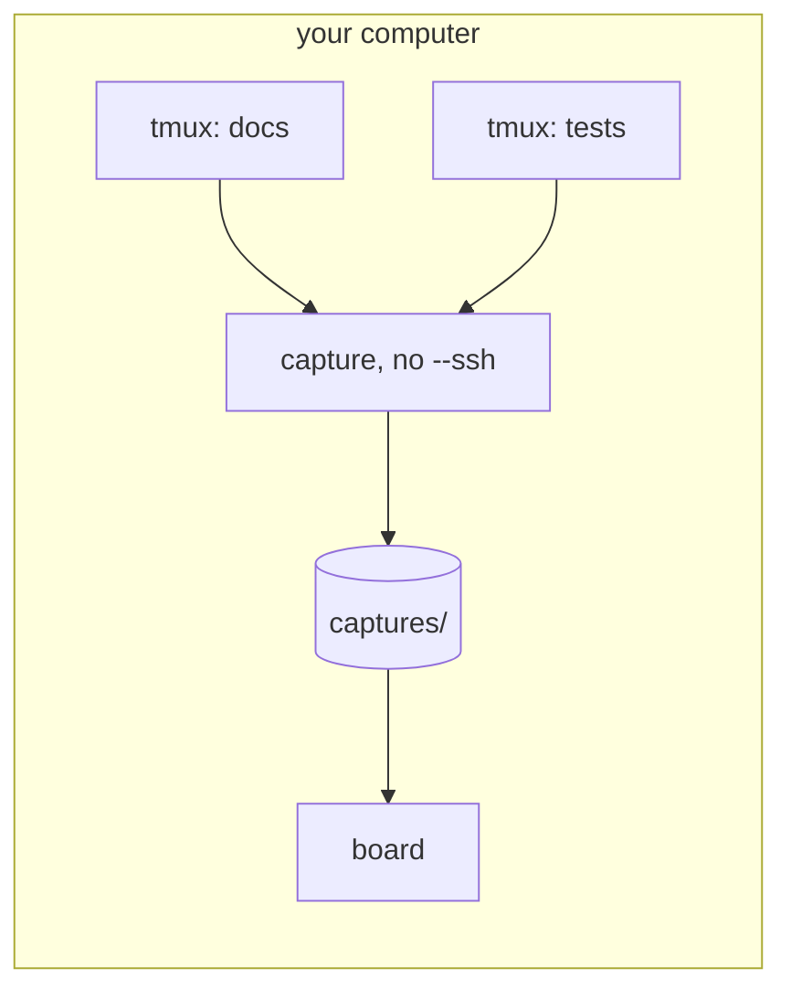
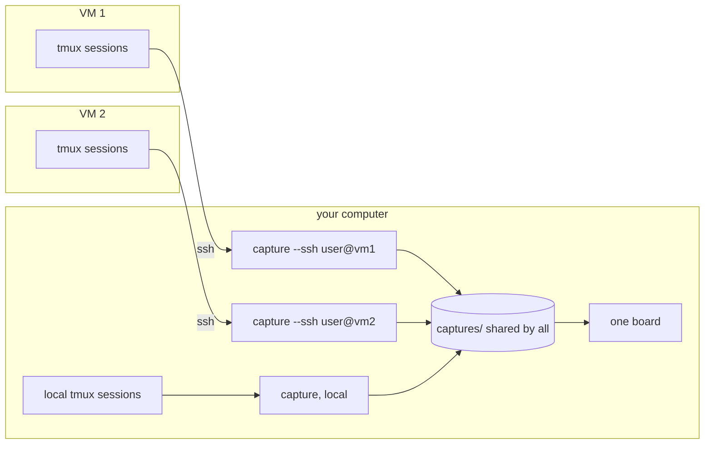
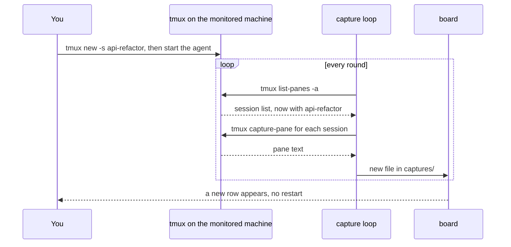
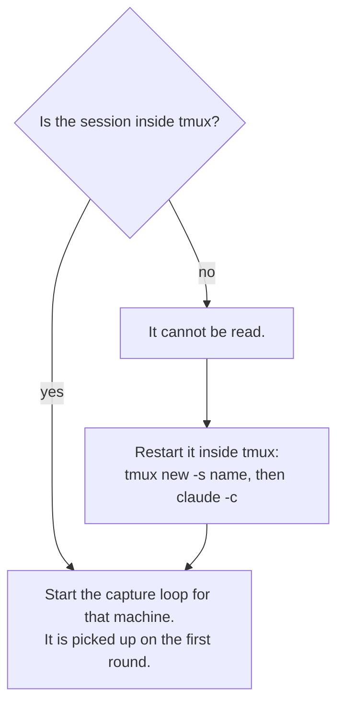
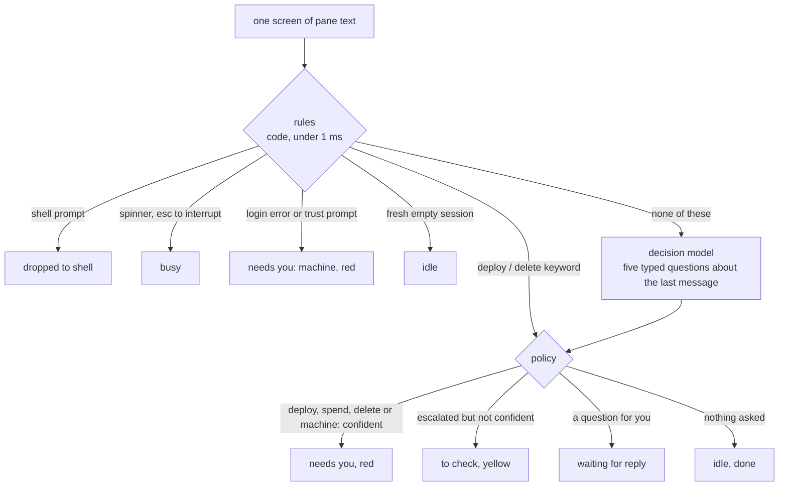

# who-needs-me

When several AI coding sessions run in parallel tmux panes, one board tells you **which
one is waiting on you, and for what**. Code decides what code can decide; a small decision
model reads only the last thing the session said; deploy, spend and delete always go to a
human.

This is not a software factory. It is one part of one: the escalation step that says when
a human has to look, plus the measurement loop that keeps that step honest.



## How it decides

```
tmux screen (with colors)
   │
 layer 0  code — receipts, not the screen's own story          src/who_needs_me/rules.py
   │  last line is a password or [y/n] question, or a pager/editor is open → needs_human: input
   │  pane runs bash, not claude            → dropped_to_shell
   │  "/login" or "API Error" in last lines → needs_human: machine
   │  "Yes, I trust this folder" dialog     → needs_human: machine
   │  the tool's own "may I?" dialog        → needs_human: approval
   │  spinner "Word… (" / "esc to interrupt"→ busy
   │  welcome banner, no conversation yet   → idle_done
   │  dim ESC[2m text in the input box      → stripped, ghost_text_ignored
   │  unchanged N min + background shell    → fact
   │  keyword tripwire on the last message  → needs_human (OR-ed with the model)
   │
 layer 1  Gemini Decision 1, one call, five questions           src/who_needs_me/decide.py
   │  turn_end: reporting_done / asking_question / awaiting_approval /
   │            waiting_on_background / unclear
   │  wants_deploy / wants_spend / wants_delete / wants_machine (yes-or-no probabilities)
   │
 layer 2  policy in code                                        src/who_needs_me/policy.py
      busy · idle_done · waiting_reply · dropped_to_shell · needs_human
      needs_human is shown red (needs you) or yellow (to check), and stays on the board
      until a human dismisses it
```

Every threshold, rule switch, keyword and question text lives in
[`factory.yaml`](factory.yaml), and what each agent tool prints lives in
[`profiles.yaml`](profiles.yaml). The classifier only reads those two files. The diagram
shows Claude Code's rules; see [Other agents and plain terminals](#other-agents-and-plain-terminals).

Each decision records `decided_by` (rule or model) and an `evidence` line that **code**
picks from the screen. The model never quotes text. The model only sees the trimmed last
message and the receipts code computed: pane command, background task, how long the
screen has been unchanged, last error line. Screens are redacted before any call.

## Results

Full tables, confusion matrix and every wrong prediction: [`eval.md`](eval.md).
All numbers are "k of n"; the holdout is small.

Data: 153 labeled screens from real sessions plus deliberately staged ones (`source: live`
/ `staged`, reported separately). Duplicate captures of stalled screens were removed,
leaving 89 distinct screens: 44 for tuning and 45 locked as the holdout.

**First evaluation (policy fixed in advance), holdout of 45:**

| scheme | needs_human caught | flagged that were right | 5-class |
|---|---|---|---|
| rules only, tripwire escalates | 7/10 | 7/9 | 35/45 |
| rules only, tripwire as hint | 1/10 | 1/1 | 30/45 |
| rules + Gemini Decision 1 | **8/10** | 8/11 | 37/45 |

It missed two. One was a real stalled session ("about 页要等用户批了才上线"): the tripwire
caught it, but in that policy the tripwire was only a hint. The thresholds had been chosen
by "fewest false alarms" on a tuning set with only 8 positives, which pushed them to the
edge of the grid.

**Second evaluation (made after seeing the first; reference only):** tripwire OR model
again, as in the original design; the lowest threshold among recall ties (0.2); and a rule
for freshly started empty sessions. Result: **10/10 caught**, at the cost of 6 false alarms
instead of 3, and an escalation rate of 16/45 instead of 11/45. Split for the board: of the
16 reported, 9 red (9/9 truly need a human) and 7 yellow (1/7).

Both runs of the model gave the same final decision on 45/45 screens, in both evaluations.
Model call latency: median 0.29 s, p95 0.44 s; rules: under 1 ms per screen. 18–20k input
tokens per 45-screen run; the API returns no cost field, so no dollar figure is given.

## Holdout lock

The evaluation holdout is `data/holdout/holdout.jsonl`: 45 distinct screens drawn from
89 (153 labels minus 64 duplicate captures of stalled screens), stratified by
(state, reason, source), seed `20261113` in `src/who_needs_me/split.py`.

```
sha256(data/holdout/holdout.jsonl) = 9021befd69250ab62fff234c185952b05e1bfc4251a72a5c75b9aa21b1744b57
```

Thresholds were chosen by `python -m who_needs_me.tune`, which reads only
`data/tuning.jsonl`. `eval.md` holds two evaluations on the same holdout: the first with
the policy fixed in advance (kept verbatim, frozen in `data/eval_v1.md`), and a second one
made **after seeing the first** (three changes from the design doc and tuning set; for
reference only).

## Run it

```bash
uv sync
uv run pytest                                   # 94 tests; one per layer-0 rule
uv run ruff check .

# replay the labeled day on the board (time slider), no tmux needed
export GEMINI_API_KEY=...                        # or add --no-model for rules only
uv run python -m who_needs_me.board --captures data/screens --replay
# open http://127.0.0.1:8765

# live: read-only capture every 30 s, then the board on the capture directory
uv run python -m who_needs_me.capture --ssh user@host --out captures --every 30
uv run python -m who_needs_me.board --captures captures

# reproduce the numbers (reuses cached model answers in data/runs/)
uv run python -m who_needs_me.tune
uv run python -m who_needs_me.eval
```

`capture.py` can only run `tmux list-panes` and `tmux capture-pane`; any other tmux
subcommand, `send-keys` included, is refused before a process starts (tested). It never
types into a session.

## Setup guide: what to monitor

Two programs, one folder between them. A **capture loop** reads the text of each tmux pane
and writes it to a folder. The **board** reads that folder and serves the page. The board
never connects to anything; add or remove capture loops and it follows.



**Requirements**

- On the machine that runs the tool: [uv](https://docs.astral.sh/uv/), and a Gemini API key
  in `GEMINI_API_KEY` (or run the board with `--no-model` for rules only).
- On every monitored machine: `tmux`. Nothing else is installed there.
- For a remote machine: `ssh user@host` must work without a password prompt
  (an SSH key, or Tailscale SSH).

**1. Install and start the board (once)**

```bash
git clone https://github.com/SeisSparrow/who-needs-me.git && cd who-needs-me
uv sync
export GEMINI_API_KEY=...
uv run python -m who_needs_me.board --captures captures --every 5
# open http://127.0.0.1:8765
```

**2. Monitor a remote VM**

One capture loop per machine, all writing to the same `captures` folder:

```bash
uv run python -m who_needs_me.capture --ssh user@my-vm --out captures --every 5
```



**3. Monitor this computer (local tmux)**

Same command without `--ssh`:

```bash
uv run python -m who_needs_me.capture --out captures --every 5
```



**4. Monitor another machine**

Start one more capture loop pointed at it, into the same folder. The board does not need a
restart; the new sessions appear on the next refresh.

```bash
uv run python -m who_needs_me.capture --ssh user@second-vm --out captures --every 5
```



**5. Monitor a new session**

Nothing to configure. Sessions are discovered from tmux on every round, so a session
started inside tmux on a machine that already has a capture loop shows up by itself:

```bash
tmux new -s api-refactor     # on the monitored machine
claude                       # or any agent CLI
```

A session that is **not** inside tmux cannot be read.



**6. Monitor sessions that already exist**

- Already running inside tmux: start the capture loop for that machine (step 2 or 3). Every
  existing tmux session is picked up on the first round.
- Running in a plain terminal, outside tmux: it cannot be attached after the fact. Restart
  it inside tmux (for Claude Code: `tmux new -s name`, then `claude -c` to continue the
  last conversation).
- Only some sessions: repeat `--session`, e.g. `--session infra --session books`.



**Running it in the background**

When you put a capture loop in the background of an interactive shell, redirect its input,
or the shell stops the job as soon as `ssh` touches the terminal:

```bash
uv run python -m who_needs_me.capture --ssh user@my-vm --out captures --every 5 > capture.log 2>&1 < /dev/null &
```

Both programs stop when their terminal closes or the computer sleeps. To keep them up, run
them inside a tmux session of their own, ideally on a machine that is always on.

**Reading the board**

- Red, *needs you*: confident that a human must act (deploy, spend, delete, or something on
  the machine such as a login or a trust prompt).
- Yellow, *to check*: escalated, but not confident. Have a look.
- A red or yellow row stays until you press Dismiss, even if the session moves on.
- Each row shows the evidence line from the session and whether a rule or the model decided.

How one screen becomes one row:



**Your own names to mask**

Hostnames, usernames, IPs, emails and tokens are masked before anything is sent to the
model. Add anything specific to you in `.redact.local` (git-ignored), one literal per line,
optionally `literal<TAB>replacement`.

**Known gaps**

- Capture files do not record the machine. Two sessions with the same name on different
  machines overwrite each other, and the board does not show which machine a session is on.
  Until that is fixed, give sessions a machine prefix (`vm2-infra`).
- Machines are not discovered automatically; each is added once with one capture command.
- Other agent tools (Codex, Gemini CLI, Qwen Code, opencode, Grok Build, Cursor CLI, Kiro CLI, Trae Agent) are read with their own profiles. See "Other agents and plain terminals" below for how far each one was checked.
- Tested with everything running on a laptop. Running the tool on the VM itself is the
  intended always-on setup and is not tested yet.

**Troubleshooting**

| Symptom | Cause and fix |
|---|---|
| Board is empty | No capture loop is writing to the folder the board reads. Check `--out` and `--captures` match. |
| A session is missing | It is not inside tmux, or it is on a machine with no capture loop. |
| Board stops updating after a few rounds | The capture loop was backgrounded without `< /dev/null` and the shell stopped it (`jobs` shows "Stopped"). |
| `ssh` asks for a password | Set up an SSH key or Tailscale SSH for that host first. |
| Every row is decided by rule | `GEMINI_API_KEY` is not set, or the board was started with `--no-model`. |

## Other agents and plain terminals

Added on 2026-11-15, after the hackathon build. The first version only understood Claude
Code's screen: a test on 2026-11-13 showed that Codex and Gemini CLI sessions appeared on the
board but were misread (their busy line was not recognised, and the prompt the user typed
was taken for the agent's message). Layer 0 now has three more sources, and the decision
model and the policy are unchanged.

**1. A profile per tool** ([`profiles.yaml`](profiles.yaml), read by `profiles.py`): what the
tool prints when it is busy, when it asks for permission, when it wants a login or a folder
to be trusted, and how a submitted prompt looks. The tool is picked from the process name
tmux reports; when that is only `node` or `python`, from what is on screen.

| Tool | Checked on | What "checked" means |
|---|---|---|
| Claude Code 2.1 | real screens | 10 screens, including its permission dialog and "Not logged in" |
| Gemini CLI 0.68 | real screens | 19 screens: busy, both approval dialogs, login, trust, finished, quit |
| Codex 0.169 | partly | 7 real screens (trust, empty, busy, quota error); approval dialogs and the finished-turn line come from its source |
| Qwen Code 0.27 | source only | English interface only; it follows `LANG` |
| opencode 1.19 | source only | 2.x changes the finished-turn line |
| Grok Build 1.0 | source only | |
| Cursor CLI 2026.11 | source only | how the conversation is drawn was not found in its bundle |
| Kiro CLI | source only | the current (V3) strings come from third-party notes, not from Amazon |
| Trae Agent | source only | no approval prompts and no hooks exist; last commit 2026-02 |

"Source only" means the strings were copied from the tool's code or documentation and a
test checks that the profile matches them
([`tests/test_profiles_from_docs.py`](tests/test_profiles_from_docs.py)). It does not mean
the tool really prints them today. Send a capture and it becomes a fixture.

A tool's own permission dialog is reported as `needs_human: approval`, red.

**2. A terminal waiting for a person, whatever runs in it** (`terminal.py`): the last line
on screen asks for a password, passphrase or username (sudo, ssh, git, ssh-keygen), asks a
yes/no question (`[Y/n]`, `(yes/no)`, ssh's unknown-host question, npx's "Ok to proceed?"),
or a pager or editor is open. Reported as `needs_human: input`: red for a question, yellow
for a pager or editor. A script stopped at `[y/N]` runs inside `bash`, so this check comes
before "dropped to shell". A program that is neither an agent nor waiting is `busy` while
its output moves.

**3. What the tool reports itself.** Two receipts that do not depend on reading the screen:

- *Terminal title.* Codex, Gemini CLI, Qwen Code and Grok Build write "Action Required"
  into the terminal title while they wait for an approval. tmux knows the title, so it
  arrives with the same read-only `list-panes` call. Seen on a real Gemini CLI session
  (`✦ Working…` → `✋ Action Required` → `◇ Ready`).
- *Hooks.* [`hook.py`](src/who_needs_me/hook.py) is one file with no dependencies. The
  tool's hook system calls it ("prompt submitted", "permission needed", "turn over") and
  it leaves a note on the tmux pane, which the capture also gets from `list-panes`.
  Nothing is sent anywhere and the capture still only reads.

```bash
uv run python -m who_needs_me.hooks                 # which tools, which file, how far checked
uv run python -m who_needs_me.hooks claude          # print the configuration
uv run python -m who_needs_me.hooks claude --write  # merge it into ~/.claude/settings.json
                                                    # (the old file is kept as a .bak copy)
# on another machine: copy hook.py there, then
python3 -m who_needs_me.hooks claude --script ~/.who-needs-me/hook.py --write
```

| Tool | "needs approval" event | Run here? |
|---|---|---|
| Claude Code | `PermissionRequest` (at once), `Notification` (after ~6 s) | yes: note on the pane within 5 s |
| Gemini CLI | `Notification` | yes: working, approval, done, session end |
| Codex | `PermissionRequest` | partly: the events before the model call arrived; the account had no quota |
| Qwen Code, Grok Build, opencode | yes | no: written from the documentation |
| Cursor CLI, Kiro CLI | none: hooks only say "working" and "done" | no |
| Trae Agent | no hooks at all | - |

How a note is used: "approval" raises `needs_human: approval` unless the screen shows the
tool working (after you allow a command, the note still says "approval" until the command
ends). "working" counts only for tools whose busy line was not checked on a real screen,
and only while the screen still changes: an interrupted turn fires no hook, and a stale
"working" would hide an idle session.

**What was measured, and what was not**

- The 305 stored Claude Code screens are read exactly as before: same deciding rule, same
  last message, same facts.
- 53 real screens captured on 2026-11-15 (10 Claude Code, 19 Gemini CLI, 7 Codex, 17
  terminal programs) are in [`tests/fixtures`](tests/fixtures), user name and tokens
  removed, each with the reading a person would give. The rules before this change read
  17 of the 53 correctly (7/10 Claude Code, 6/19 Gemini CLI, 1/7 Codex, 3/17 terminal: every
  Gemini screen was taken for a trust prompt, and a script stopped at `[Y/n]` for an idle
  shell); now all 53 are.
- **That is a regression test, not an accuracy figure.** The rules were written while
  looking at those screens. There is no held-out set for the new tools.
- `eval.md` is still about Claude Code only. How well the decision model reads the last
  message of another tool has not been measured.

Also found on the way: Claude Code draws its bullet as `●` on Linux and `⏺` on macOS, and
tmux names its process after its version on macOS (`2.1.325`); both are handled now.

## Data and privacy

- `data/screens/`: redacted captures. Internal IPs, hostnames, emails, tokens, usernames
  (including those inside OSC 8 hyperlinks and Claude Code's path slugs) are replaced;
  colors are kept. The labeling tool refuses to start if anything still looks sensitive.
- `data/labels.jsonl`: append-only labels; corrections are new rows.
- `data/runs/`: cached model answers, so tuning and evaluation re-run without new calls.
- Raw captures, live captures (`captures/`) and the API key never enter the repo.

## Who did what

- **Human (the author):** the design, the labels for all 153 screens and the labeling
  conventions, staging the missing cases, every threshold-selection rule, the decision to
  publish the first evaluation unchanged, and what got merged.
- **Agent (Claude Code):** the code, the tests, and running the tools. Every model call and
  every number in `eval.md` comes from the scripts in this repo.

## Limits

- The holdout has 10 needs_human screens and two evaluations ran on it; the second is not
  an unbiased estimate.
- Staged screens are real screens, but staged. Live and staged are reported separately.
- One decision model only (Gemini Decision 1). The layer-1 function is backend-agnostic;
  a shadow second model was planned but not built.
- Autonomy level: L1. It only reads and escalates; it never answers for you.
