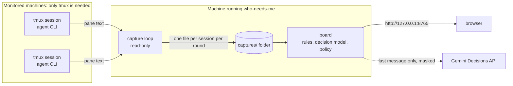
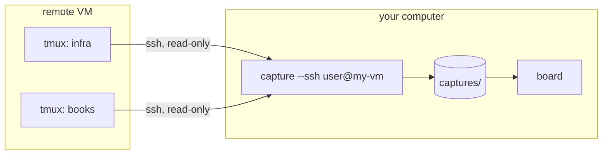
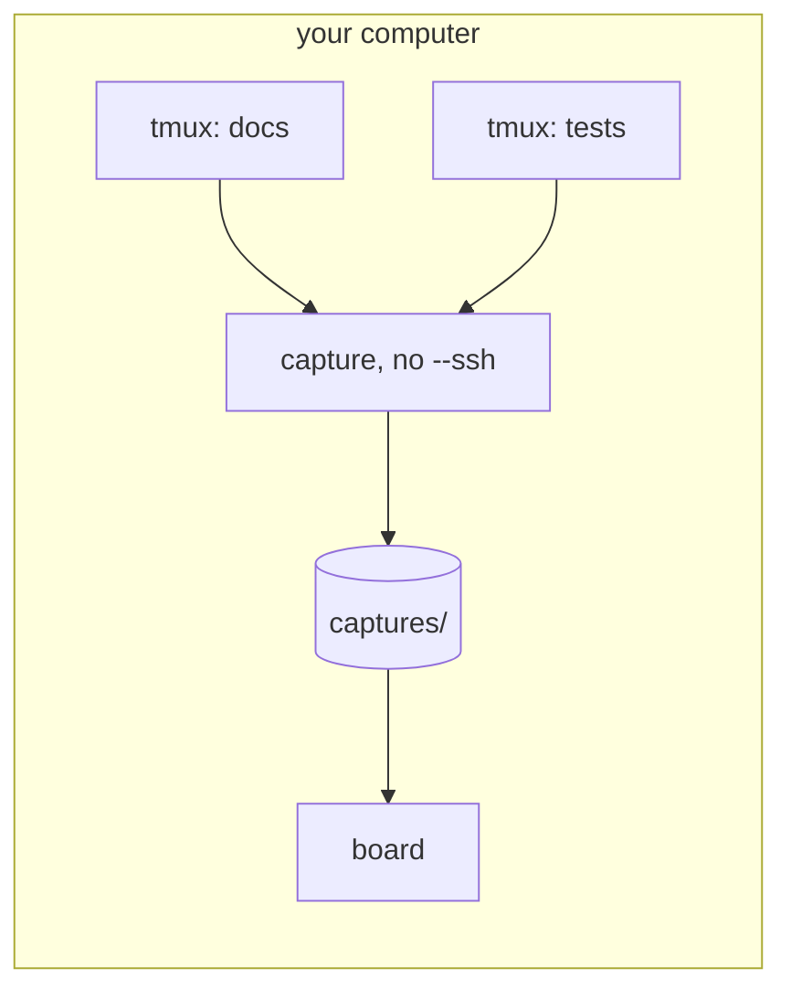
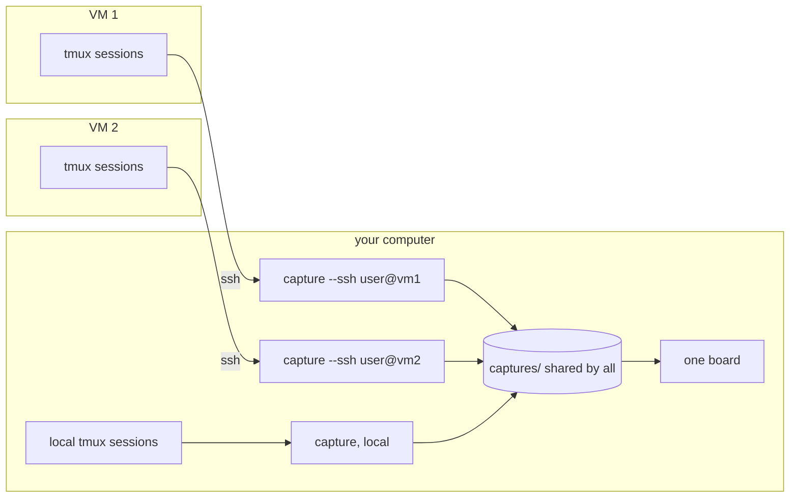
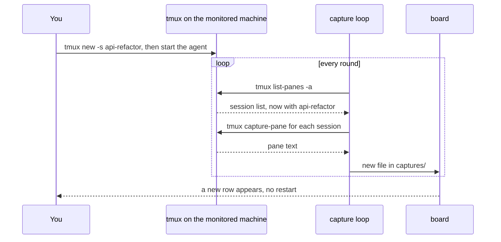
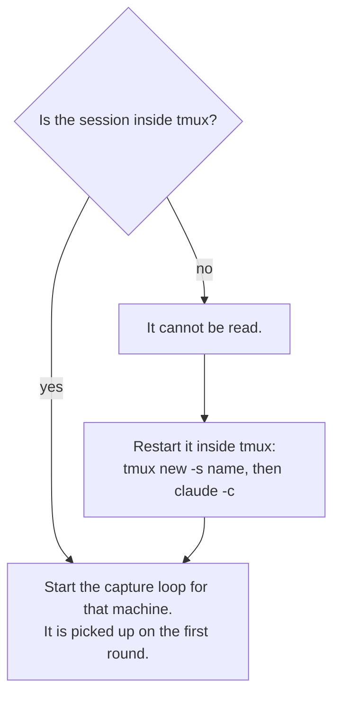
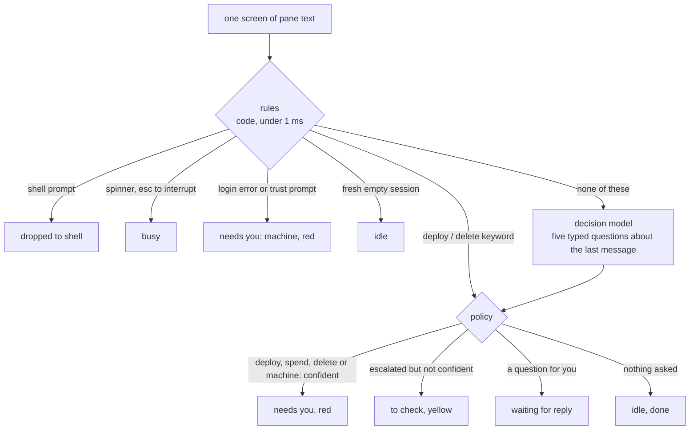

# who-needs-me

When several AI coding sessions run in parallel tmux panes, one board tells you **which
one is waiting on you, and for what**. Code decides what code can decide; a small decision
model reads only the last thing the session said; deploy, spend and delete always go to a
human.

This is not a software factory. It is one part of one: the escalation step that says when
a human has to look, plus the measurement loop that keeps that step honest.


## How it decides

```
tmux screen (with colors)
   │
 layer 0  code — receipts, not the screen's own story          src/who_needs_me/rules.py
   │  pane runs bash, not claude            → dropped_to_shell
   │  "/login" or "API Error" in last lines → needs_human: machine
   │  "Yes, I trust this folder" dialog     → needs_human: machine
   │  spinner "Word… (" / "esc to interrupt"→ busy
   │  welcome banner, no conversation yet   → idle_done
   │  dim ESC[2m text in the input box      → stripped, ghost_text_ignored
   │  unchanged N min + background shell    → fact
   │  keyword tripwire on the last message  → needs_human (OR-ed with the model)
   │
 layer 1  Gemini Decision 1, one call, five questions           src/who_needs_me/decide.py
   │  turn_end: reporting_done / asking_question / awaiting_approval /
   │            waiting_on_background / unclear
   │  wants_deploy / wants_spend / wants_delete / wants_machine (yes-or-no probabilities)
   │
 layer 2  policy in code                                        src/who_needs_me/policy.py
      busy · idle_done · waiting_reply · dropped_to_shell · needs_human
      needs_human is shown red (needs you) or yellow (to check), and stays on the board
      until a human dismisses it
```

Every threshold, rule switch, keyword and question text lives in
[`factory.yaml`](factory.yaml). The classifier only reads that file.

Each decision records `decided_by` (rule or model) and an `evidence` line that **code**
picks from the screen. The model never quotes text. The model only sees the trimmed last
message and the receipts code computed: pane command, background task, how long the
screen has been unchanged, last error line. Screens are redacted before any call.

## Results

Full tables, confusion matrix and every wrong prediction: [`eval.md`](eval.md).
All numbers are "k of n"; the holdout is small.

Data: 153 labeled screens from real sessions plus deliberately staged ones (`source: live`
/ `staged`, reported separately). Duplicate captures of stalled screens were removed,
leaving 89 distinct screens: 44 for tuning and 45 locked as the holdout.

**First evaluation (policy fixed in advance), holdout of 45:**

| scheme | needs_human caught | flagged that were right | 5-class |
|---|---|---|---|
| rules only, tripwire escalates | 7/10 | 7/9 | 35/45 |
| rules only, tripwire as hint | 1/10 | 1/1 | 30/45 |
| rules + Gemini Decision 1 | **8/10** | 8/11 | 37/45 |

It missed two. One was a real stalled session ("about 页要等用户批了才上线"): the tripwire
caught it, but in that policy the tripwire was only a hint. The thresholds had been chosen
by "fewest false alarms" on a tuning set with only 8 positives, which pushed them to the
edge of the grid.

**Second evaluation (made after seeing the first; reference only):** tripwire OR model
again, as in the original design; the lowest threshold among recall ties (0.2); and a rule
for freshly started empty sessions. Result: **10/10 caught**, at the cost of 6 false alarms
instead of 3, and an escalation rate of 16/45 instead of 11/45. Split for the board: of the
16 reported, 9 red (9/9 truly need a human) and 7 yellow (1/7).

Both runs of the model gave the same final decision on 45/45 screens, in both evaluations.
Model call latency: median 0.29 s, p95 0.44 s; rules: under 1 ms per screen. 18–20k input
tokens per 45-screen run; the API returns no cost field, so no dollar figure is given.

## Holdout lock

The evaluation holdout is `data/holdout/holdout.jsonl`: 45 distinct screens drawn from
89 (153 labels minus 64 duplicate captures of stalled screens), stratified by
(state, reason, source), seed `20261113` in `src/who_needs_me/split.py`.

```
sha256(data/holdout/holdout.jsonl) = 9021befd69250ab62fff234c185952b05e1bfc4251a72a5c75b9aa21b1744b57
```

Thresholds were chosen by `python -m who_needs_me.tune`, which reads only
`data/tuning.jsonl`. `eval.md` holds two evaluations on the same holdout: the first with
the policy fixed in advance (kept verbatim, frozen in `data/eval_v1.md`), and a second one
made **after seeing the first** (three changes from the design doc and tuning set; for
reference only).

## Run it

```bash
uv sync
uv run pytest                                   # 94 tests; one per layer-0 rule
uv run ruff check .

# replay the labeled day on the board (time slider), no tmux needed
export GEMINI_API_KEY=...                        # or add --no-model for rules only
uv run python -m who_needs_me.board --captures data/screens --replay
# open http://127.0.0.1:8765

# live: read-only capture every 30 s, then the board on the capture directory
uv run python -m who_needs_me.capture --ssh user@host --out captures --every 30
uv run python -m who_needs_me.board --captures captures

# reproduce the numbers (reuses cached model answers in data/runs/)
uv run python -m who_needs_me.tune
uv run python -m who_needs_me.eval
```

`capture.py` can only run `tmux list-panes` and `tmux capture-pane`; any other tmux
subcommand, `send-keys` included, is refused before a process starts (tested). It never
types into a session.

## Setup guide: what to monitor

Two programs, one folder between them. A **capture loop** reads the text of each tmux pane
and writes it to a folder. The **board** reads that folder and serves the page. The board
never connects to anything; add or remove capture loops and it follows.



**Requirements**

- On the machine that runs the tool: [uv](https://docs.astral.sh/uv/), and a Gemini API key
  in `GEMINI_API_KEY` (or run the board with `--no-model` for rules only).
- On every monitored machine: `tmux`. Nothing else is installed there.
- For a remote machine: `ssh user@host` must work without a password prompt
  (an SSH key, or Tailscale SSH).

**1. Install and start the board (once)**

```bash
git clone https://github.com/SeisSparrow/who-needs-me.git && cd who-needs-me
uv sync
export GEMINI_API_KEY=...
uv run python -m who_needs_me.board --captures captures --every 5
# open http://127.0.0.1:8765
```

**2. Monitor a remote VM**

One capture loop per machine, all writing to the same `captures` folder:

```bash
uv run python -m who_needs_me.capture --ssh user@my-vm --out captures --every 5
```



**3. Monitor this computer (local tmux)**

Same command without `--ssh`:

```bash
uv run python -m who_needs_me.capture --out captures --every 5
```



**4. Monitor another machine**

Start one more capture loop pointed at it, into the same folder. The board does not need a
restart; the new sessions appear on the next refresh.

```bash
uv run python -m who_needs_me.capture --ssh user@second-vm --out captures --every 5
```



**5. Monitor a new session**

Nothing to configure. Sessions are discovered from tmux on every round, so a session
started inside tmux on a machine that already has a capture loop shows up by itself:

```bash
tmux new -s api-refactor     # on the monitored machine
claude                       # or any agent CLI
```

A session that is **not** inside tmux cannot be read.



**6. Monitor sessions that already exist**

- Already running inside tmux: start the capture loop for that machine (step 2 or 3). Every
  existing tmux session is picked up on the first round.
- Running in a plain terminal, outside tmux: it cannot be attached after the fact. Restart
  it inside tmux (for Claude Code: `tmux new -s name`, then `claude -c` to continue the
  last conversation).
- Only some sessions: repeat `--session`, e.g. `--session infra --session books`.



**Running it in the background**

When you put a capture loop in the background of an interactive shell, redirect its input,
or the shell stops the job as soon as `ssh` touches the terminal:

```bash
uv run python -m who_needs_me.capture --ssh user@my-vm --out captures --every 5 > capture.log 2>&1 < /dev/null &
```

Both programs stop when their terminal closes or the computer sleeps. To keep them up, run
them inside a tmux session of their own, ideally on a machine that is always on.

**Reading the board**

- Red, *needs you*: confident that a human must act (deploy, spend, delete, or something on
  the machine such as a login or a trust prompt).
- Yellow, *to check*: escalated, but not confident. Have a look.
- A red or yellow row stays until you press Dismiss, even if the session moves on.
- Each row shows the evidence line from the session and whether a rule or the model decided.

How one screen becomes one row:



**Your own names to mask**

Hostnames, usernames, IPs, emails and tokens are masked before anything is sent to the
model. Add anything specific to you in `.redact.local` (git-ignored), one literal per line,
optionally `literal<TAB>replacement`.

**Known gaps**

- Capture files do not record the machine. Two sessions with the same name on different
  machines overwrite each other, and the board does not show which machine a session is on.
  Until that is fixed, give sessions a machine prefix (`vm2-infra`).
- Machines are not discovered automatically; each is added once with one capture command.
- The rules are written for the Claude Code terminal interface. See "Other agents" below for what happens with Codex and Gemini CLI.
- Tested with everything running on a laptop. Running the tool on the VM itself is the
  intended always-on setup and is not tested yet.

**Troubleshooting**

| Symptom | Cause and fix |
|---|---|
| Board is empty | No capture loop is writing to the folder the board reads. Check `--out` and `--captures` match. |
| A session is missing | It is not inside tmux, or it is on a machine with no capture loop. |
| Board stops updating after a few rounds | The capture loop was backgrounded without `< /dev/null` and the shell stopped it (`jobs` shows "Stopped"). |
| `ssh` asks for a password | Set up an SSH key or Tailscale SSH for that host first. |
| Every row is decided by rule | `GEMINI_API_KEY` is not set, or the board was started with `--no-model`. |

## Other agents: Codex and Gemini CLI

Tested on 2026-11-13 after the build, with Claude Code, Codex and Gemini CLI running side
by side in local tmux sessions. No code was changed for this; it documents what the
current version does. Short version: **the capture, the decision model and the board are
tool-agnostic; the rule layer is written for Claude Code and misreads the other two.**

| Stage | Claude Code | Codex | Gemini CLI |
|---|---|---|---|
| Session discovered, shown on the board | yes | yes | yes |
| Just started, empty prompt | idle (correct) | "waiting for reply" (should be idle) | "waiting for reply" (should be idle) |
| Startup dialog that needs a person | trust prompt: needs you, red (correct) | sign-in choice, browser sign-in, folder approval: all escalated (correct) | not seen |
| Working on a task | busy (correct) | **not recognized**: `Working (6s • Esc to interrupt)` does not match the rule | not tested |
| Finished, asks to deploy | needs you: deploy, red (correct) | not tested | not tested |
| API error on screen | login error: needs you (correct) | escalated, but for the wrong reason (see below) | escalated, but for the wrong reason |
| Exited to the shell | dropped to shell (correct) | dropped to shell (correct) | dropped to shell (correct) |

What this showed:

- **Dropping to the shell works for all three**, because it uses the command tmux reports
  for the pane, not the screen. (tmux reports `node` for Codex and Gemini CLI, and a version
  string for Claude Code on macOS; none of these is a shell.)
- **Busy detection is Claude Code only.** Codex prints its own spinner line and the rule
  does not match it.
- **The echoed prompt is read as the session's message.** Codex and Gemini CLI show the
  text you typed on the screen. The last-message extraction is built around Claude Code's
  layout, so it picked up the typed task ("... I will do it once you approve") and flagged
  the session for that, while the real state was an API error.
- **Their error messages are not recognized.** Only Claude Code's login error has a rule.
- **Not tested: a Codex or Gemini session that is actually answering.** On the test
  machine both CLIs were too old for their current models (Codex 0.34.0, Gemini CLI 0.1.13)
  and every request failed. If they were installed with npm, update them with
  `npm install -g @openai/codex@latest @google/gemini-cli@latest`.
- **Also found with Claude Code:** when a session asks for approval and then, without an
  answer, asks a plain question, the earlier request is still on the screen and the row
  stays yellow for deploy.

Supporting another agent means giving it its own small rule set: its busy marker, its
input box, its error strings, and how to skip the echoed prompt. Nothing else changes.

## Data and privacy

- `data/screens/`: redacted captures. Internal IPs, hostnames, emails, tokens, usernames
  (including those inside OSC 8 hyperlinks and Claude Code's path slugs) are replaced;
  colors are kept. The labeling tool refuses to start if anything still looks sensitive.
- `data/labels.jsonl`: append-only labels; corrections are new rows.
- `data/runs/`: cached model answers, so tuning and evaluation re-run without new calls.
- Raw captures, live captures (`captures/`) and the API key never enter the repo.

## Who did what

- **Human (the author):** the design, the labels for all 153 screens and the labeling
  conventions, staging the missing cases, every threshold-selection rule, the decision to
  publish the first evaluation unchanged, and what got merged.
- **Agent (Claude Code):** the code, the tests, and running the tools. Every model call and
  every number in `eval.md` comes from the scripts in this repo.

## Limits

- The holdout has 10 needs_human screens and two evaluations ran on it; the second is not
  an unbiased estimate.
- Staged screens are real screens, but staged. Live and staged are reported separately.
- One decision model only (Gemini Decision 1). The layer-1 function is backend-agnostic;
  a shadow second model was planned but not built.
- Autonomy level: L1. It only reads and escalates; it never answers for you.
